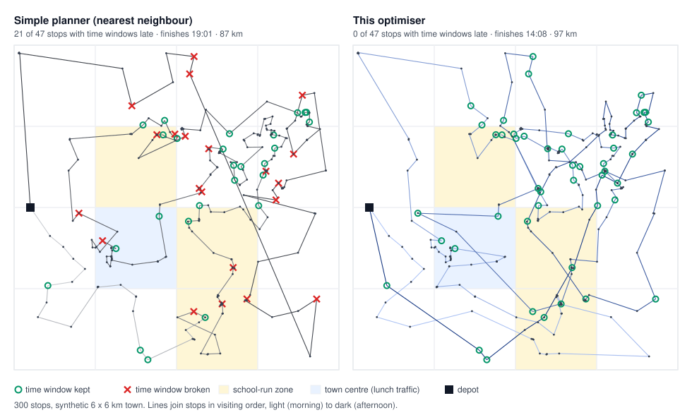

# route-optimizer

[](https://github.com/MuhammadSaadSiddique/route-optimizer/actions/workflows/ci.yml)

Offline, time-dependent route optimisation for multi-drop delivery apps, in pure Dart. It runs inside a Flutter app in a background isolate, with optional C++ kernels through `dart:ffi`.



| | |
|---|---|
| **Time windows** | Timed collections, customer slots and business hours. Planned rounds break zero windows. |
| **Predictive travel times** | Congestion per zone and 15-minute slot (school run, peaks), FIFO-correct. |
| **Learns from GPS** | Speeds learned from driven legs, with cold-start fallbacks. ETA error drops from 4.4 to 0.9 min. |
| **Or-opt / relocate / 2-opt** | Neighbour lists, don't-look bits, and an exact O(1) feasibility check proven against brute force. |
| **Anytime improvement** | Ruin & recreate within a time budget, so the app always gets the best route so far. |
| **Live insertion** | A new collection is placed exactly in about 10 µs, with 0 stops reordered. |
| **Park Once** | Nearby doors are grouped into one van stop with an optimal walking order: 300 doors become 186 van stops, and the day ends 74 min earlier. |
| **Safety margin** | Routes keep room before deadlines, so mid-round work still fits. |
| **Driver control** | Propose, accept, reject and revert, with instant, exact versions. |
| **C++ via FFI** | The matrix lives in shared native memory, with batched leaf calls. Results are bit-identical to Dart. |

## Quick start

```bash
dart pub get
dart test                      # 37 tests
dart run bin/benchmark.dart    # every number in this README (~30 s)
```

Optional native kernels, needed for the FFI tests and benchmark section 8:

```bash
bash tool/build_native.sh                                          # Linux / macOS
cmake -S native -B native/out && cmake --build native/out --config Release   # Windows
```

Without the library, everything else works and the FFI tests are skipped.

## Usage

```dart
import 'dart:isolate';
import 'package:route_optimizer/route_optimizer.dart';

// Plan in a background isolate, keeping 10 minutes before every deadline.
final route = await Isolate.run(() =>
    planRound(problem.withDeadlineBuffer(600), budget: const Duration(seconds: 1)).schedule.route);
final plan = Schedule.compute(problem, route);

// A collection comes in mid-round: one matrix row/column, then an exact placement.
final id = problem.addStop(collection, timeTo: toRow, timeFrom: fromRow, distTo: toDist, distFrom: fromDist);
final neighbours = NeighbourLists(problem)..addNode(id);
final result = DynamicInserter(problem, neighbours).insert(plan, currentPosition, id);

// The driver decides.
final session = RouteSession(problem, plan);
print(session.propose(result.schedule!, 'New collection')); // +1 stop, 0 reordered, finish +0m52s, ...
session.accept(); // or reject(); revert() restores the previous version exactly

// Each evening: learn congestion from the day's GPS legs and use it tomorrow.
learner.recordAll(todaysLegs);
final tomorrow = problem.withTravel(problem.travel.withProfile(learner.buildProfile()));
```

---

## Results

Synthetic 6 × 6 km town with 16 congestion zones, morning and evening peaks, a school run in 3 zones and a lunchtime slowdown in the centre.
About half the houses are neighbours on the same street, and about half the flats share a block.
All data is seeded. Timings are from one run on a cloud VM, and time-budgeted plans vary slightly between runs.

### 1. Planning a full round

| Stops | Windows | Simple planner*: finish / km / **broken** | This: first route | finish / km / **broken** |
|---:|---:|---|---:|---|
| 200 | 30 | 17:00 / 67.2 / **10** | 97 ms | 13:45 / 73.4 / **0** |
| 300 | 47 | 19:01 / 86.6 / **21** | 87 ms | 14:08 / 96.7 / **0** |
| 500 | 88 | 21:21 / 108.7 / **60** | 53 ms | 17:21 / 123.5 / **0** |

\*Nearest neighbour by distance, ignoring windows and traffic.
With windows ignored, i.e. on the simple planner's own terms, this optimiser drives **13–18% less** (58.6 / 71.4 / 90.4 km).
So the extra km above is the price of keeping every window, not a weaker optimiser.
"First route" is a window-safe route ready to drive. The rest of the 1 / 1.5 / 3 s budget is anytime improvement.

### 2. Why the congestion model matters (300 stops, 8 towns)

A plan that ignores traffic promised a finish **13.5 min too early** on average and **broke 2 windows per round** on the real road.
With the congestion model: **0 broken windows**, and the day ended 6.5 min earlier. The main gain is ETAs you can trust.

### 3. Learning traffic from GPS history (300 stops, 6 towns)

Each past day is a round driven in traffic with random variation (±12% per leg, ±5% per day), and its legs feed the learner.
Accuracy is measured on new rounds against the true average traffic.

| History | ETA error per stop | at finish | late windows (no margin) |
|---|---:|---:|---:|
| none (base map) | 4.4 min | 6.2 min | 1.2 |
| 1 day | 1.5 min | 1.4 min | 0.2 |
| 5 days | 1.3 min | 1.7 min | 0.5 |
| 20 days | 0.9 min | 1.1 min | 0.2 |

Zones and times with no data fall back to the fleet's time-of-day pattern, then to free-flow speeds, so they're never worse than the base map.
The values move by about ±0.5 min with the random traffic of the training days.

### 4. Safety margin (300 stops, 4 towns)

| Margin before deadlines | Finish | km | New mid-round collections still servable |
|---:|---:|---:|---:|
| 0 min | – | 99.1 | 74.3% |
| **10 min** | +2.1 min | 100.9 | **91.5%** |
| 15 min | +7.8 min | 104.1 | 98.0% |

### 5. Live insertion (timed collection at midday, 300 stops)

```
Checked 79 positions exactly (O(1) each) in 4 us. Served 13:58 (window 13:30-14:00).
Rest of the round: finish +0.9 min, 0 stops reordered, 0 windows broken.
1,000 random requests: 98.4% servable; decision time mean 9 us, p95 19 us.
```

### 6. Park Once (300 doors, 45 s to park per van stop)

| | Van stops | Finish | Driving | Walking | Broken |
|---|---:|---:|---:|---:|---:|
| Van stops at every door | 300 | 19:07 | 3h10 | 1h20 | 0 |
| Park Once | **186** | **17:53** | 3h09 | 1h30 | 0 |

Both use the same cost model. Example guidance: *park at stop 5, walk 121 → 9 → 20 → 152 → 8, back to the van (72 m)*.

### 7. Driver learning with cold start

A new driver gets the fleet's service time (110 s at flats). Their own pace (about 80 s) takes over as data comes in: 98 s after 5 deliveries and 83 s after 50.

### 8. C++ kernels via `dart:ffi`

| | Dart (JIT) | C++ |
|---|---:|---:|
| 1,000,000 time-dependent legs (one call) | 24 ms | 17 ms |
| Full 501 × 501 time-dependent snapshot | 4.2 ms | 2.0 ms |

0 mismatches: the results are bit-identical. Dart is already fast here. The point is the integration pattern used with embedded native routing: shared memory, batched leaf calls and native finalizers.

---

## How it works

1. **FIFO time-dependent travel (Ichoua–Gendreau–Potvin).**
   Speed is constant per zone and 15-minute slot, and travel time is integrated across the slots a trip crosses.
   The common shortcut, `freeFlow / speed(departure slot)`, lets a driver arrive earlier by leaving later, which makes local search accept fake improvements. A test shows the shortcut failing.
   → `travel_time.dart`

2. **Exact O(1) feasibility with latest-start times.**
   A backward pass, using the exact inverse of the travel function, stores the latest start at each position that keeps the *whole rest of the round* feasible.
   A change ahead of position *k* is then feasible iff its new start at *k* ≤ `latestStart[k]`.
   This agrees with full re-simulation in 5,000 random cases.
   → `Schedule.insertionShift`

3. **Two-stage move evaluation.**
   A time-aware O(1) screen comes first: new arcs are priced at their real departure time, so "serve this zone before the school run" counts as a saving.
   Survivors get an exact check that simulates only the changed part and checks the tail in O(1). It also matches brute force.
   Measured: 96–99% of candidates never need the exact check.
   → `Schedule.spliceCost`

4. **Neighbour lists and don't-look bits.**
   Moves are only tried towards each stop's 16 nearest neighbours, so each sweep is O(n·K).

5. **Anytime ruin & recreate.**
   Each iteration removes either a cluster of nearby stops, or two stretches of the route that pass the same streets at different times.
   It reinserts them window-safely and polishes them with local search.
   A shrinking acceptance threshold escapes local optima. An iteration cap makes results reproducible.

6. **Live insertion with route stability.**
   Driven stops are locked, and every remaining gap is checked in O(1).
   Repair only applies changes that save at least 60 s, so the route stays recognisable. If a stop can't be served, the result says why.

7. **Learning speeds with cold start.**
   Speeds are a ratio of sums (free-flow / observed), so predicted times are unbiased.
   Each estimate falls back in layers: this zone and slot → neighbouring slots → fleet at that time → free flow.
   Each leg is capped at 2.5× what's expected there, so one GPS glitch can't distort a zone.
   → `speed_learning.dart`

8. **Park Once.**
   Doors join a group only if walking is cheaper than driving and parking separately, and only if every door's window still holds.
   The parking spot and walking order are optimal (brute force over ≤ 6 doors). Timed collections keep their own van stop.
   → `park_once.dart`

9. **Safety margin and driver control.**
   Plan against deadlines brought forward and run against the real ones.
   Every version is an immutable `Schedule`, so revert is instant and exact.

10. **Mobile memory.**
    16-bit travel times mean 500 stops take ~0.5 MB.
    Congestion is a zones × 96 overlay that syncs as data, with no map rebuild.
    Spare matrix capacity means a new stop costs one row and one column.

## In a real app

| Here (synthetic) | In production |
|---|---|
| `CityInstance` distances | Valhalla `sources_to_targets` writing straight into the native matrix (`NativeKernels.allocateMatrix`), cached in Drift |
| `RoadSimulator` legs | Map-matched GPS legs (Meili) → `SpeedProfileLearner` → `CongestionProfile` synced to phones |
| Synthetic service times | Arrival → departure scans → `ServiceTimeModel` |
| Park Once matrix | One Valhalla call between parking spots |
| Benchmark calls | `Isolate.run(() => planRound(...))` from the UI, then `RouteSession` for driver decisions |

The optimiser only depends on the `TravelModel` interface, so swapping data sources doesn't touch the algorithms.

## Tests (37)

- **Exactness:** the O(1) insertion check and the splice evaluation are compared with full re-simulation in 5,000 random cases each, covering both feasible and infeasible outcomes.
- **Travel model:** FIFO and the exact inverse are checked on 20,000 random cases each, plus a test showing the naive model breaking FIFO.
- **Optimiser:**
  - Never breaks a window and never makes a route worse
  - Respects locked stops
  - Stays within its time budget
  - Is reproducible with an iteration cap
- **Live insertion, safety margin, and accept / reject / revert.**
- **Learning:**
  - Recovers known speeds
  - Falls back correctly on cold start
  - Resists outliers
  - Cuts ETA error by at least 40% across 6 towns
- **Park Once:**
  - Covers every stop exactly once
  - Respects walking limits
  - Keeps every door inside its window
  - Saves time
- **C++ kernels:** bit-identical to Dart on 200,000 legs and a full snapshot, with shared memory and profile sync. Skipped if the library isn't built.

## Limitations

- **Single driver per round.** A multi-vehicle split would add a clustering stage first.
- **Arc congestion uses the average of the two end zones.** Per-road-segment profiles would plug in behind the same interface.
- **Benchmarks use a synthetic town.** Real rounds need replaying against scanned arrival times, and benchmarks on target phones.
- **Park Once uses straight-line walking distance × 1.25.** Footpath routing would replace it.
- **No vehicle capacity constraint.** It rarely binds for parcel vans, and it's straightforward to add to the schedule pass.

## Layout

```
lib/route_optimizer.dart        public API          lib/native.dart   optional FFI API
lib/src/travel_time.dart        FIFO time-dependent travel, compact matrix, congestion profile
lib/src/schedule.dart           forward times, latest-start pass, O(1) checks, exact splice evaluation
lib/src/construction.dart       window-aware insertion; nearest-neighbour baseline
lib/src/local_search.dart       relocate / Or-opt / 2-opt, two-stage evaluation
lib/src/ruin_recreate.dart      anytime improvement
lib/src/planner.dart            full pipeline with time budget or iteration cap
lib/src/dynamic_insertion.dart  live insertion with stability-limited repair
lib/src/session.dart            propose / accept / reject / revert
lib/src/speed_learning.dart     congestion learning with cold start
lib/src/service_time.dart       service-time learning with cold start
lib/src/park_once.dart          Park Once grouping and walking order
lib/src/simulation.dart         replays routes on the "real road"
lib/src/native_kernels.dart     dart:ffi bindings
native/                         C++ kernels (route_kernels.cpp, CMakeLists.txt)
bin/benchmark.dart              all results above      bin/route_map.dart   docs/route_map.svg
```

MIT licence.
